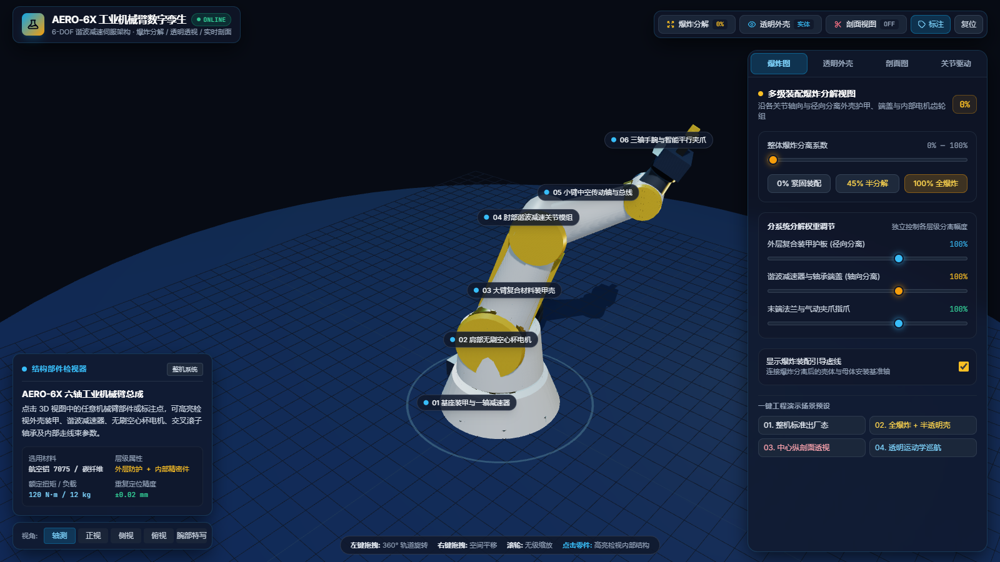

# AERO-6X 六轴机械臂数字孪生

一个在浏览器里运行的六轴工业机械臂数字孪生演示：六轴关节实时驱动、多级爆炸分解、四种外壳显示、X/Y/Z 剖面、部件标注与检视器。所有依赖已本地化，下载后双击 `index.html` 即可离线使用。

**在线演示：<https://www.sakura.work.gd/aero-6x-digital-twin/>**



## 功能

| 模块 | 能力 |
|---|---|
| 关节驱动 | J1–J6 六个关节滑杆、夹爪开合、自动巡航、归零姿态 |
| 爆炸图 | 0/45/100% 预设，外壳、减速器、末端三组分离权重独立调节 |
| 透明外壳 | 实体 / 22% 透视 / 线框 / 剥离四种模式，外壳透明度连续可调 |
| 内部图层 | 电机、减速器与轴承、桁架、线束四类内部件独立显隐 |
| 剖面图 | X/Y/Z 三向裁剪、位置滑杆、方向翻转、剖面辅助面与高亮 |
| 检视器 | 6 个总成标注点，点击部件或标注查看材料、层级与规格 |
| 视角 | 轴测、正视、侧视、俯视、腕部特写 |
| 演示 | 自动巡航、一键复位、标准出厂态 / 全爆炸 / 中心剖面等场景预设 |

## 直接使用

下载仓库里的 `index.html` 和 `vendor/` 目录，保持相对位置不变，双击 `index.html`。不需要 Node.js、服务器或网络。

## 本地开发

这是一个无构建步骤的静态页面。修改 `index.html` 后刷新即可。Three.js、Tailwind 运行时和 Inter / JetBrains Mono 字体都在 `vendor/` 下，页面不会发起外部请求。

```text
index.html          页面结构、样式与全部交互逻辑
vendor/
  three.min.js      Three.js r128
  tailwind-3.4.17.js Tailwind Play CDN 运行时（本地副本）
  fonts.css         本地字体声明
  fonts/            Inter / JetBrains Mono 的拉丁字形
```

## 交互

- 左键拖拽旋转，右键拖拽平移，滚轮缩放。
- 右侧控制坞四个标签页分别控制爆炸、外壳、剖面和关节。
- 点击模型或标注点，左下角检视器显示部件信息。
- 顶部快捷按钮可一键切换爆炸、透视、剖面和标注。
- 页面按桌面宽度设计，建议 1280px 以上；窄屏下控制面板会占满视口，3D 模型会被遮挡。

## 说明

这是用于交互演示和结构讲解的数字孪生模型，几何按教学展示比例程序化构建。页面中的材料、扭矩、负载和重复定位精度等字段是演示用的标称参数，不代表对任何实物机械臂的实测结果。

## License

MIT
